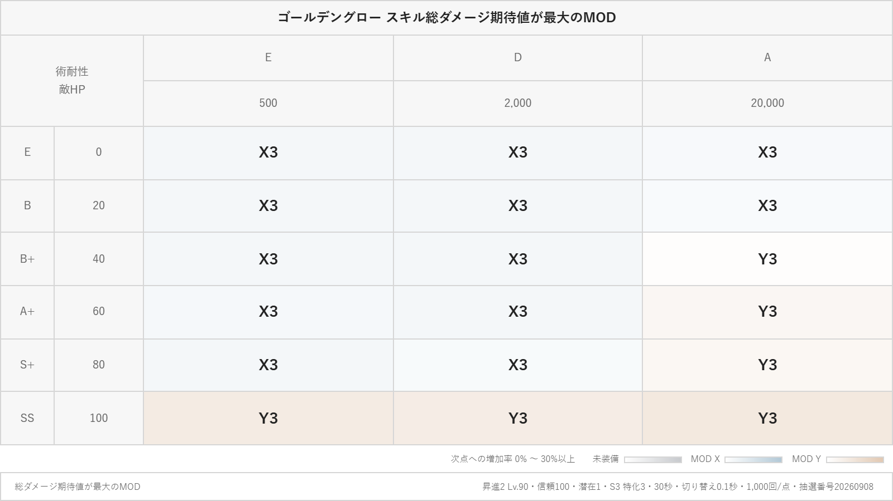
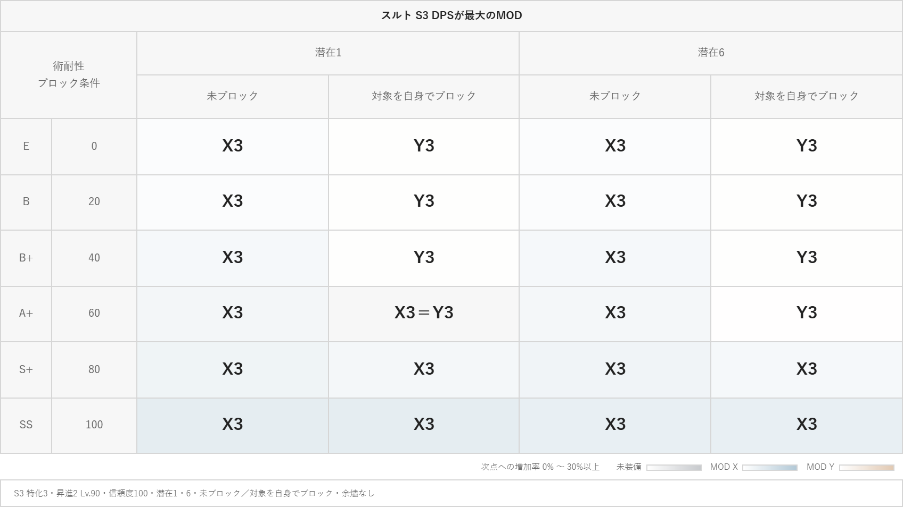

# MOD比較テーブルの共通出力

GG「ターゲット切替3」とスルトの比較表で使う、テーブル表示・PNG出力の共通基盤。各ページの計算式と比較基準はページ側で保持する。

## 共通部品

| 部品 | 役割 |
| --- | --- |
| [ComparisonTableImageFrame](../../src/components/ComparisonTableImageFrame.tsx) / [CSS](../../src/components/ComparisonTableImageFrame.css) | 表全体の実測、指定比率、タイトル・詳細の帯、数値サイズ、欠け・画素数上限の検出、保存前プレビュー |
| [ComparisonTableImageOptions](../../src/components/ComparisonTableImageOptions.tsx) | 配置、数値サイズ、タイトル・詳細サイズの共通設定 |
| [tableImageTypography](../../src/lib/tableImageTypography.ts) | 文字サイズの選択肢・初期値・全数値セルを同じサイズにする計算 |
| [ModuleWinnerTable](../../src/components/ModuleWinnerTable.tsx) / [CSS](../../src/components/ModuleWinnerTable.css) | 条件2軸の最大MOD表、転置、ランク・潜在などの見出し、均等列幅、MOD色・差濃淡 |
| [moduleTableWinner](../../src/lib/moduleTableWinner.ts) | 未丸め絶対値から最大・同率・次点との差を判定 |
| [ChartImageSaveDialog](../../src/components/ChartImageSaveDialog.tsx) / [saveComparisonChartImage](../../src/components/saveComparisonChartImage.tsx) | 既存のファイル名・比率・保存先UI、共通PNG生成 |
| [pngZipArchive](../../src/lib/pngZipArchive.ts) | 段階ごとのPNGをZIPへ格納 |

## 固定する振る舞い

- 数値表と最大MOD表は切り替え式。元の数値・計算条件・比較値は変更しない。
- 最大MODは選択された候補の絶対DPS／総ダメージ期待値から判定する。非表示の比較元を自動的に候補へ追加しない。
- 同率は浮動小数点の丸め誤差だけ許容し、同率候補をすべて表示する。表示桁で丸めて勝者を決めない。
- 候補に欠損・不正値があれば、そのセルは比較不能とする。欠損候補だけを除外して最大を選ばない。
- 「最大のスキル」は同じMOD・段階のS2とS3を絶対DPSで比較する。`ModuleWinnerTable` の `candidateKind="skill"` を使い、候補の短縮名・色を明示する。MODの種類や段階からスキルの色を推測しない。差濃淡の次点も同じ比較単位で決める。
- 潜在など比較対象外の軸は見出しとして残す。スルトでは同じ潜在・ブロック条件の中でMODを比較する。
- 最大MOD表のセルは一行表示・同じ列幅・同じ行高を維持する。長い同率名は最長名に合わせて全列を確保する。
- MOD色は [MOD共通配色](../module-colors/README.md) を使う。差濃淡ではMODの種類を色相、次点への増加率を濃淡として使い、段階別の濃淡を重ねない。
- 差濃淡は初期OFF。次点は選択候補の2番目の値（同じMODの別段階も含む）で、増加率は `(最大値−次点)/次点×100`。同率は0%、次点0は算出不能。色の上限は共通定数を参照する。
- 画像ではタイトル・詳細の帯を自然な高さに保ち、指定比率による余白を表のデータ行へ均等に配分する。
- 数値と勝者名のサイズは全対象セルで揃え、最も余裕のないセルに合わせる。指定なしは内容に合わせ、指定比率でも全文・全行・全列を保つ。収まらない場合はエラーとし、画像を切り取らない。
- PNGは2倍描画。寸法・画素数上限は [tableImageAspect](../../src/lib/tableImageAspect.ts) と共通フレームを定義元とする。

## 利用側が渡すもの

- 計算済みデータ、選択MOD・段階、表示する行列、ページ固有の比較基準。
- タイトル・詳細の文言、初期幅、画像配置に応じた表の内容。
- 各数値セルに `data-table-image-number`。内側に別の文字設定がある場合は、その要素へ `data-table-image-number-text` を付ける。
- 設定・データを含む `layoutKey`。画面・プレビュー・PNGには同じ保存時点のスナップショットを渡す。

```tsx
// title / conditions / matrix は利用側で作る保存対象のスナップショット。
<ComparisonTableImageFrame initialWidth={800} title={title} footer={conditions}
  typography={typography} aspectRatio={ratio} layoutKey={snapshotKey}>
  <ModuleWinnerTable data={matrix} color="module" gapShading={gapShading} forImage />
</ComparisonTableImageFrame>
```

文字サイズの初期値・選択肢は `tableImageTypography` を参照する。既存の対象外ページの初期値を保持する場合を除き、別の固定値を利用側に複製しない。保存する配置は、通常・転置・条件ごとの上下・段階別分割をページの軸へ対応付ける。分割時も比較元のデータを保持し、比較値の色尺度は分割前の表全体で固定する。

## 適用箇所

| ページ | 固有の軸・内容 |
| --- | --- |
| [GGターゲット切替3](../../src/components/GoldenglowTargetSwitchThreePage.tsx) | 敵HP・術耐性・MOD段階。総ダメージ／比較値／両方／最大MOD。HP上下・段階分割 |
| [スルトS3 MOD・潜在比較](../../src/components/SurtrS3ComparisonPage.tsx) | 術耐性・潜在・ブロック条件・MOD段階。比較値／DPS＋比較値／最大MOD。ブロック上下・段階分割 |
| [スルトS2・S3 DPS比較](../../src/components/SurtrSkillComparisonPage.tsx) | 数値表／スキルごとの最大MOD／MODごとの最大スキル。最大MOD表の上下配置は全候補を保ったスキル別、最大スキル表の上下配置はMOD別。スキル色は [SurtrSkillComparisonWinnerTable](../../src/components/SurtrSkillComparisonWinnerTable.tsx) から画面・画像へ渡す |

スルトの既存比較表を利用する他ページも画像の測定・プレビューは共通化されるが、高度な配置・数値サイズ・最大MODの選択は `enableImageLayouts` など利用側の指定で有効になる。スルト総ダメージ表の既存出力は独立したままとする。グラフ画像の枠にはこの表用フレームを使わず、[グラフ画像テンプレート](../chart-image/README.md) を使う。

## 見本と確認

`examples/` は実際のアプリ出力から保存した見本。再生成する場合は対象ページで比較条件を設定し、「画像を保存」から同じ表の形式・画像配置・縦横比を選んでPNGを保存する。ダミーの絵で代替しない。

- [GG最大MOD表・16:9](examples/goldenglow-winner-16x9.png)：HP 500・2,000・20,000、術耐性0〜100／20刻み、S3特化3、全段階、1,000試行、抽選番号20260908、ランク結合、差濃淡ON。
- [スルト最大MOD表・16:9](examples/surtr-winner-16x9.png)：未装備・X3・Y3、潜在1・6、術耐性0〜100／20刻み、S3特化3、余燼なし、ランク結合、差濃淡ON。





変更時は関連ユニットテストとビルドに加え、両ページの実画面・プレビュー・PNGを確認する。通常／転置／上下／段階分割、ZIP内の段階と値、指定なし／16:9／9:16、数値サイズ、長い同率名、複数潜在、非表示比較元、欠損値、モバイル幅を含める。色・数値・列幅・ランクの結合と、タイトル・詳細が欠けていないことを確認する。
