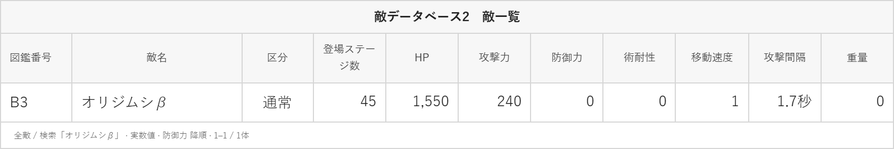

# 敵データベース2の敵一覧

ホームの「敵」またはメニューから「敵データベース2」（`#/enemies-2`）を開く。「敵データベース」（`#/enemies`）と同じ敵データ・評価基準を使う。

## 表の画像保存

「敵一覧」の保存ボタンは、選択中のページの全行（最大100体）と全11列をPNGにする。絞り込み、ステータス表記、並び順と該当件数のうち何体目から何体目までかを画像に記録する。画面と画像は[同じ表](../../src/components/EnemyDatabase2Results.tsx)を使い、比率・プレビュー・保存先の選択は[共通の表画像ダイアログ](../../src/components/ComparisonTableImageDialog.tsx)で扱う。

見本を再生成するには、対象の敵を「すべて」にして「オリジムシβ」で検索し、「実数値」を選ぶ。「防御力」列を押して降順にし、「敵一覧」の画像保存から比率「自動」で保存する。
