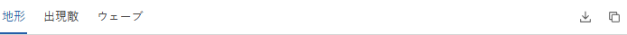

# 新規ページの標準構造

新しいページは「防御力と術耐性の対応」を基準に作る。本文には上から集計条件などの共通設定、結果の切り替え、選択中の結果を並べる。設定がなければ結果から始め、結果が1種類ならそのまま表示する。既存ページへの適用はページ構造の変更を依頼された範囲とする。

## 新しいページを追加するとき

設計時に、設定と結果のどのまとまりをチャットで個別に指すかを[アドレスコピーの仕様](../element-location-copy/README.md)に沿って決める。以下の出力部品を選ぶ前に、`settings` に置くセクションも含めて確認する。

1. [ルートの定義](../../src/lib/routes.ts)にページを追加し、[ナビゲーションの定義](../../src/lib/navigation.ts)の `STANDARD_PAGE_TITLES` にルートの `view` と表示名を登録する。メニューに載せる場合は、その表示名をメニュー項目の `label` にも使う。
2. [App.tsx](../../src/App.tsx) でルートをページにつなぐ。共通ヘッドバーが登録したページ名を `h1` として表示する。本文は [PageLayout](../../src/components/PageLayout.tsx) で包み、`page` に同じルート名を渡す。全体に効く設定は `settings`、結果固有の操作は結果の近くに置く。
3. 下表から出力の形を選ぶ。出力は本文に直接配置し、表やグラフとパネルの二重枠、本文で繰り返すページタイトル、説明だけの帯を省く。ヘッドバーとメニューはアプリ側が提供する。

| 出力の形 | 使う部品 |
| --- | --- |
| 結果が1つ | `PageOutputHeader` と結果を並べる。見出しや表示切替は左、画像保存・アドレスコピーは右に置く。ページ名だけで対象が分かり、保存操作もなければ `<PageOutputHeader />` で足りる。 |
| 結果が複数 | `PageOutputTabs` にタブの定義と選択状態を渡す。下線付きタブと右端のコピーが一緒に表示される。各結果は同じ `idPrefix` と `activeTab` の [AnalysisTabPanel](../../src/components/AnalysisTabs.tsx) に置く。 |
| 同じ結果を表・グラフなどに切り替える | [PageViewSwitch](../../src/components/PageViewSwitch.tsx) を結果の上に置く。選択中の表示名を `PageOutputTabs` の `format` に渡す。単一出力では `PageOutputHeader` の `segments` に渡す。 |

本文幅・中央寄せ・設定行の折り返しとコピー位置は [PageLayout.css](../../src/components/PageLayout.css) が定義する。本文の上限は960px。狭い画面では共通のページ余白の内側に収まり、ヘッドバーは画面幅を使う。アドレスの書式や既存要素への適用範囲は[アドレスコピーの仕様](../element-location-copy/README.md)に従う。

## 画像保存ボタン

グラフやテーブルを新しく作るとき、または作り直すときは、原則としてPNG保存を実装案に含め、画面表示と同時に実装する。既存ページにグラフや表をタブや表示形式として追加する場合も同様とする。画面表示のみという指定がある場合は、その指定を優先する。

表とグラフを切り替える場合は、どちらの形式からも、表示中の条件でその結果を保存できるようにする。[グラフ画像出力の仕様](../chart-image/README.md)または[テーブル画像出力の仕様](../../instructions/shared/table-image.md)に従い、各形式でプレビューと実際に保存したPNGの内容が画面の結果と一致することを確認する。

マップ・表・グラフの保存ボタンは「TDマップ詳細」の地形タブを配置の基準とする。

- 結果が1つなら見出し行、タブで切り替える場合はタブ行の右端に、左から「画像を保存」「アドレスコピー」の順に並べる。[PageOutputHeader・PageOutputTabs](../../src/components/PageLayout.tsx) の `actions` に保存ボタンを渡す。タブや表示形式によって保存対象が変わる場合は表示中の結果に結び付け、保存できる表示でだけボタンを出す。
- 保存ダイアログを開くボタンには [OutputImageSaveButton](../../src/components/OutputImageSaveButton.tsx) を使う。通常時は受け皿に向かう下矢印だけを表示する。[共通スタイル](../../src/components/ElementLocationCopyButton.css)でアドレスコピーと大きさ・色・ホバー・フォーカス表示をそろえ、狭い画面やタッチ操作では押せる範囲を広げる。
- ボタンの読み上げ名は「画像を保存」とし、保存ダイアログを開く場合は `aria-haspopup="dialog"` を付ける。[TDマップの保存ボタン](../../src/components/TdMapImage.tsx) と[タブへの配置](../../src/components/TdMapPage.tsx)を実装例とする。



見本を更新するときは、`#/maps/td?stage=TD-8` で「地形」の「経路」を選び、ライト表示・表示領域1210×740 CSS px・倍率100%でタブ行を撮影する。

## 最小の使用例

次は登録したルート名を `sample-results`、表示名を「集計結果」とした場合の例。コンポーネントは `src/components/` に置く想定。ページ固有の結果と、その結果の保存ダイアログを開く関数を渡す。右端のボタンは `〈集計結果〉` をコピーする。

```tsx
import type { ReactNode } from 'react'
import { OutputImageSaveButton } from './OutputImageSaveButton'
import { PageLayout, PageOutputHeader } from './PageLayout'

export function SampleResultsPage({ result, openImageSave }: { result: ReactNode; openImageSave: () => void }) {
  return <PageLayout page="sample-results">
    <PageOutputHeader actions={<OutputImageSaveButton onClick={openImageSave} />} />
    {result}
  </PageLayout>
}
```

複数結果の使用例は[防御力と術耐性の対応ページ](../../src/components/EnemyDefenseResistancePage.tsx)。タブ名を変えるとタブとコピーの両方に反映される。タブや表示形式に使う名前は1か所に定義する。

## 見本と確認

[基準ページの画面見本](examples/defense-resistance.png)は、設定・タブ・表のそろい方を見るためのもの。集計値やタブ数は各ページで決める。見本を更新する場合は、機能確認用サーバーで `#/analysis/enemies/defense-resistance?aggregationVersion=v12` を開く。ブラウザーの表示領域を1210×740 CSS px、表示倍率を100%にし、「全体」「順位帯の範囲」「表」を選んでページ先頭を撮る。

- PCでは設定・タブ・出力の左右端、スマートフォンではページ全体の横はみ出しと各操作の押しやすさを確認する。
- ページ名がヘッドバーに1回だけ表示され、タブや表示形式を切り替えるとコピー内容が追随することを確かめる。タブを設ける場合は左右矢印キーでの移動も確認する。
